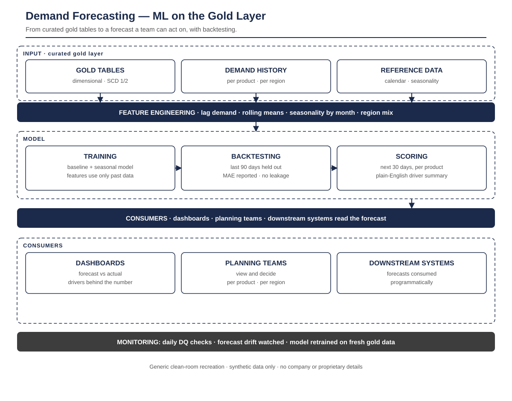
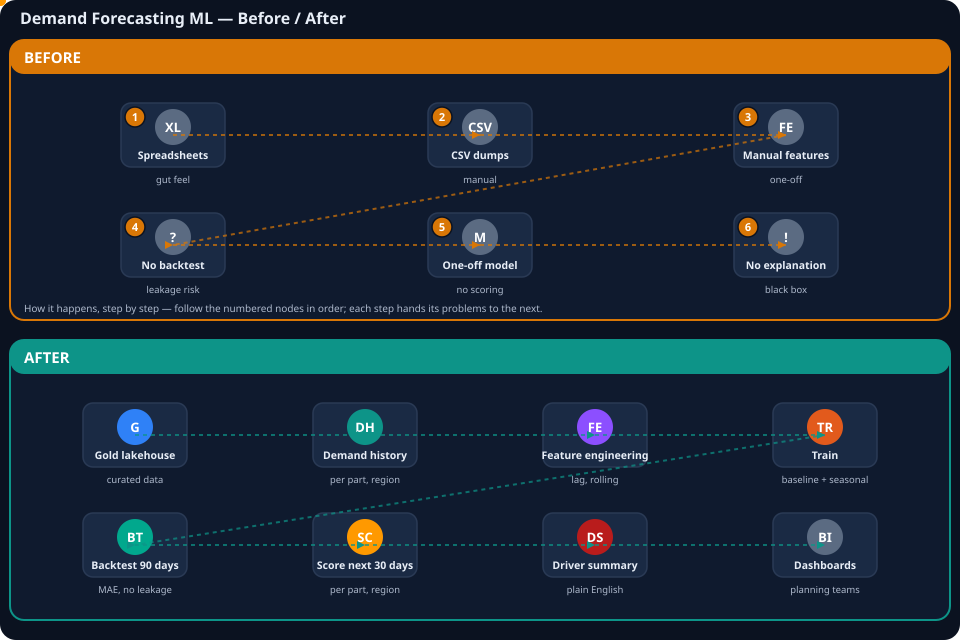

# Demand Forecasting with ML

A transparent, explainable demand-forecasting baseline in pure Python
(standard library only, no ML frameworks to install). It generates
synthetic daily demand history, validates it, builds leakage-free
features, fits one baseline + seasonal model per part and region, scores
it on a held-out backtest, and forecasts the next 30 days with a
plain-English driver summary.

**Original context:** An ML product for internal teams to predict parts
and service demand, improving forecast accuracy and cutting costs, built
on top of curated lakehouse data.

**This portfolio version:** A small clean-room recreation of that
pattern at demo scale. It is not production code and it is not a claim
about accuracy on real data: the backtest MAE it reports is whatever the
run computes on synthetic data. In production, this same pattern was
implemented with PySpark feature pipelines over much larger data
volumes.

## Synthetic data disclaimer

All data in this repo is invented for demonstration: three generic part
labels, three generic region labels, a base demand level, a region
multiplier, an annual seasonal wave, and Gaussian noise. There are no
real products, customers, locations, or employer details anywhere in the
code, config, tests, or docs. The numbers the model reports (baselines,
seasonal factors, backtest MAE) are computed from that synthetic data at
run time; none are hard-coded or asserted as real-world results.

## Setup

Python 3.10+ required. No runtime dependencies.

```bash
python3 -m venv .venv
source .venv/bin/activate
pip install -e ".[dev]"   # editable install + pytest
```

Without a virtual environment, run the modules from the repo root with
the source tree on the path instead:

```bash
PYTHONPATH=src python3 -m demand_forecast.train --help
```

## Run

```bash
# 1. Generate synthetic history (seeded, so re-runs are identical)
python -m demand_forecast.generate_data --out data/demand.csv

# 2. Validate, quarantine bad rows, train one model per part/region
python -m demand_forecast.train --data data/demand.csv --out models/model.json

# 3. Forecast the next 30 days for one part (all regions) or one region
python -m demand_forecast.score --model models/model.json --part "brake pad"
python -m demand_forecast.score --model models/model.json --part "brake pad" --region North --horizon 7
```

`train` logs row counts in / out / rejected on every run, and writes any
quarantined rows to a CSV (`--quarantine-out`, default
`data/quarantine.csv` when rows are rejected). `score` prints one JSON
object per (part, region) to stdout, including the per-day forecast and
a `driver_summary`. Example output (from a real run on the synthetic
data; values change with the seed/config):

```json
{
  "part": "brake pad",
  "region": "North",
  "horizon_days": 7,
  "backtest_mae": 16.17,
  "driver_summary": "Forecast for 'brake pad' in 'North' averages about 122 units/day over the next 7 days. The recent 28-day average is 119 units/day, and June seasonality multiplies that by 1.03. Held-out backtest MAE over the last 90 days was 16.2 units."
}
```

## Test

```bash
python -m pytest tests/ -q
```

57 tests, one file per module plus an end-to-end CLI test
(`generate` -> `train` -> `score`). They cover feature leakage,
schema validation and quarantine, model fitting and backtesting,
configuration validation, deterministic data generation, and CLI
failure paths (unknown part/region, missing model file, bad horizon,
too-short history).

## How it works

- **Features** (`features.py`): lag-1 demand and a 28-day rolling mean,
  built only from past data, so there is no leakage.
- **Model** (`model.py`): a transparent baseline (recent rolling mean)
  times a per-month seasonal index computed from the training period
  only. Months with no training history default to a factor of 1.0.
- **Backtest**: the last 90 days are held out. Each held-out day is
  forecast walk-forward from history strictly before it, and MAE is
  reported. No future data is used anywhere.
- **Output**: per part, per region forecast for the next 30 days, with
  a plain-English driver summary.

## Data quality

Every input row is validated before training: required columns
`date, part, region, demand`; ISO dates; non-empty part/region; demand
numeric, finite, and >= 0; no duplicate `(date, part, region)` rows
(first occurrence wins). Bad rows are quarantined with a reason, counted
and logged, and optionally written to a CSV for inspection. They are
never silently dropped.

## Project layout

```
src/demand_forecast/
  __init__.py       package exports
  config.py         all tunables (ForecastConfig); JSON config file support
  data.py           CSV loading, schema validation, quarantine, grouping
  exceptions.py     custom error types (config / data / model / unknown part)
  features.py       leakage-free lag + rolling-mean features
  generate_data.py  seeded synthetic data generator + CLI
  logging_setup.py  one logging format for every module
  model.py          baseline + seasonal model, walk-forward backtest, summary
  score.py          scoring CLI (JSON forecast + driver summary)
  train.py          training pipeline CLI (validate -> fit -> atomic write)
tests/              one test module per source module + end-to-end CLI tests
config.example.json example JSON config (same values as the defaults)
```

Configuration lives in `config.py` (`ForecastConfig`) and can be
overridden with a JSON file (`--config`, see `config.example.json`) or
with CLI flags. Nothing in the code hard-codes a file path, a product,
or a credential: paths are CLI arguments with documented defaults, and
there are no credentials at all. The pipeline makes no network or API
calls, so there is no retry/backoff logic to add; training writes the
model file atomically (temp file + rename), and re-running `generate`
or `train` on the same config reproduces the same output, so both steps
are idempotent.

## Architecture



### Before / After

Hover any component to see what it is and why it is needed.


<details>
<summary><b>Feature engineering + backtest — click to expand the 4 steps</b></summary>

Collapsed, this is just: Feature engineering -> Train -> Backtest 90 days -> Score next 30 days

1. Lag demand, rolling means and seasonality are built only from past data, so there is no leakage.
2. A transparent baseline and seasonal model is trained, so the method can be explained.
3. Backtest: the last 90 days are held out and scored with MAE, so accuracy is measured honestly.
4. Scores forecast the next 30 days by part and region, with a plain-English driver summary.
</details>

### Earlier issues, risk, and impact after

| Aspect | Detail |
|---|---|
| Earlier issues | Forecasts kept in spreadsheets and gut feel, hard to repeat or check; historical data dumped by hand, stale before it is used; features built once by hand, so they drift and cannot be reused; no held-out backtest; a model built once with no scoring entry point, so it never reached the team; no driver summary, so teams could not tell why a forecast moved. |
| Risk | A model could look good by accidentally using future data; a forecast nobody could check or repeat could drive a real planning decision; features could drift silently. |
| Impact after | Forecasts start from curated lakehouse data; features use only past data, so no leakage; the last 90 days are held out and scored with MAE; every forecast ships with a plain-English driver summary and reaches dashboards and planning teams. |

## Limitations (deliberately simple)

- The model is a rolling-mean baseline with a monthly seasonal factor.
  It is explainable, not powerful: it cannot learn trends, promotions,
  price changes, or interactions, and it lags a trending series (the
  backtest MAE shows this honestly).
- Features are per (part, region) series only; there is no cross-part
  or cross-region modelling, and no external regressors.
- The generator's seasonal wave is a single annual sine wave; real
  demand seasonality is messier.
- No scheduling, serving, or monitoring is included: this repo covers
  generate -> validate -> train -> backtest -> score, which is the
  part a reviewer can run and check.
